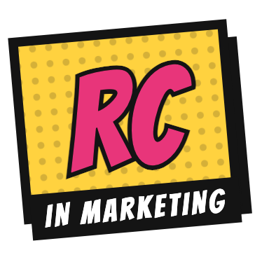

<p align="center"><a href="https://www.youtube.com/@rc-inmarketing"></a></p>

<h1 align="center">Content and Video Studio</h1>

<p align="center">Plan your content, then edit your short-form videos, all in one browser tab.</p>

## What it is

Content and Video Studio is a free, local tool for creators who post short videos on LinkedIn, Instagram, TikTok, YouTube, X and Substack. It brings your content plan and your video editor into one place, so the idea, the script, the shot list, the edit and the caption for each platform all live together.

It runs in your browser and keeps everything on your computer. There's no account, no upload and nothing to install except Python 3. Bring your own videos, music, sounds and images: none are included.

## What you can do

**Plan**

- **Board:** move each video from Idea → Filming → Editing → Ready → Posted.
- **Calendar:** a week and month view, with each post's version per platform: LinkedIn, Instagram, TikTok, YouTube, X and Substack.
- **Video details:** for each video, write the script, build a shot list, and keep a note for Claude. Below those, a caption for each platform.
- **Send to the editor:** link your clips to the shot list, then send them to the timeline in order.
- **Polish with Sound Like Me:** send a video's script to [Sound Like Me](https://github.com/rcinmarketing/do-not-sound-like-ai) to rewrite it in your voice and write a caption for each platform, then paste it all back with **Paste from Sound Like Me**. Your voice profile comes back too, and **Send notes to Claude** includes it from then on. [How it works](https://github.com/rcinmarketing/do-not-sound-like-ai/blob/main/VIDEO-STUDIO.md).

**Edit**

- **9:16 safe zones:** see where TikTok, Reels and Shorts cover your video, and edit the zones to fit your layout. Your zones are saved.
- **Timeline:**
  - cut (<kbd>S</kbd>), trim (drag an edge) and reorder (drag a clip);
  - slip (<kbd>⌥ Option</kbd>-drag a clip, voice or music piece);
  - sound fades: drag the round handles on any clip, voice or music piece, and double-click a handle for no fade.
- **Captions and text effects:** checks that text stays inside the safe zones.
- **Export:** to a video file, right in the browser.

## Run it

```bash
python3 -I serve.py --port 4321
```

Then open http://127.0.0.1:4321. You only need Python 3 (standard library); there's nothing to install.

## Your own assets (optional)

Make an `assets/` folder next to `index.html`:

- **Stickers:** put PNG, WebP or JPEG files in `assets/stickers/` and list them in `assets/stickers/index.json`, like this: `[{ "file": "star.png", "label": "Star", "w": 300 }]`.
- **Music picks:** put audio files in `assets/music/` and list them in `assets/music/options.json`, like this: `[{ "file": "track.mp3", "label": "Upbeat" }]`. Only use music you have the rights to.
- **Effect sounds:** the text effects play `assets/sfx/comic/<name>.wav` if you add one. Without them, the effects are silent.

## Privacy and security

- **Your media stays on your computer.** The videos and audio you add are read by your browser and kept in its local storage (IndexedDB). Nothing is uploaded anywhere. Plans, projects and safe zones are kept in `localStorage`.
- **Network use is downloads only.** The page fetches:
  - Google Fonts;
  - the MediaPipe Tasks Vision library (pinned to version 0.10.14, from cdn.jsdelivr.net);
  - its selfie-segmentation model (from storage.googleapis.com), used on your device for "behind me" text.

  Those hosts can see your IP address. **Polish with Sound Like Me** opens the Sound Like Me page in a new tab; the script goes there through your clipboard, not over the network. A Content Security Policy blocks every other host. The social links in the footer only open when you click them.
- **The server is local and read-only.** `serve.py` listens on 127.0.0.1 only.
  - It answers GET and HEAD and nothing else.
  - It serves only files inside this folder with a short list of media and page extensions: no `..`, no absolute paths, no hidden files, no symlinks out, and no directory listings.
  - It rejects requests whose `Host` isn't `localhost` or `127.0.0.1` (a guard against DNS rebinding).
  - It sends `nosniff`, a same-origin resource policy and no-frame headers.
- **Don't expose it to the internet.** Don't put `serve.py` behind a tunnel or a public host. Anyone who reached it could read the media files you keep in this folder.
- **Keep your footage out of git.** `.gitignore` excludes video files, `assets/`, exports and key files. Check `git status` before you commit.

## License

Made by [Rizza Carla Ramos](https://www.linkedin.com/in/rizzacarlaramos/) ([RC in Marketing](https://github.com/rcinmarketing)). Free to use, adapt and share under the [MIT License with Attribution Requirement](LICENSE): any copy or version of Content and Video Studio must keep the credit footer visible, and shared copies must credit RC in Marketing with a link back to this repo.

---

<p align="right">
  <b>FOLLOW RC IN MARKETING</b><br>
  <a href="https://www.linkedin.com/in/rizzacarlaramos/" title="LinkedIn"></a>&nbsp;
  <a href="https://www.instagram.com/rcinmarketing/" title="Instagram"></a>&nbsp;
  <a href="https://www.tiktok.com/@rcinmarketing" title="TikTok"></a>&nbsp;
  <a href="https://www.youtube.com/@rc-inmarketing" title="YouTube"></a>
</p>
